<p align="center">
  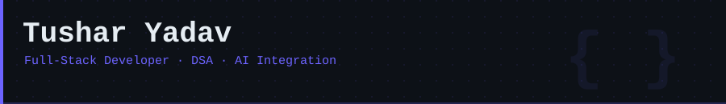
</p>

<p align="center">
  <a href="https://www.linkedin.com/in/tushar-yadav24/">
    
  </a>
  &nbsp;
  <a href="mailto:krishnasinghyadav24@gmail.com">
    
  </a>
  &nbsp;
  <a href="https://github.com/tusharyadav24?tab=repositories">
    
  </a>
  &nbsp;
  
</p>

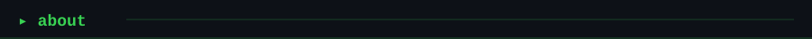

```yaml
whoami:
  name         : Tushar Yadav
  role         : Full-Stack Developer · DSA Enthusiast · AI Builder
  builds       : production-ready MERN apps, AI-integrated web tools, scalable backends
  sharpening   : DSA in C++ & Java, System Design, ML API integration
  approach     : "build fast, ship clean, refactor smart"
  open_to      : [internships, collaborations, open-source contributions]
```

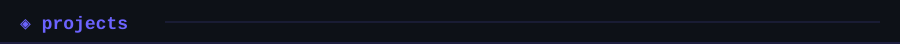

<table>
  <tr>
    <td>
      <a href="https://github.com/tusharyadav24">
        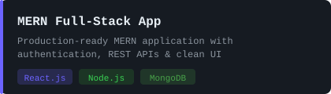
      </a>
    </td>
    <td>
      <a href="https://github.com/tusharyadav24">
        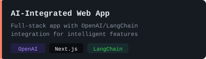
      </a>
    </td>
  </tr>
  <tr>
    <td>
      <a href="https://github.com/tusharyadav24">
        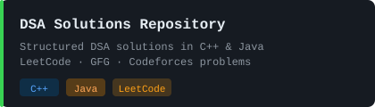
      </a>
    </td>
    <td>
      <a href="https://github.com/tusharyadav24">
        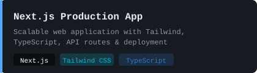
      </a>
    </td>
  </tr>
</table>

<p align="center"><sub>More in my <a href="https://github.com/tusharyadav24?tab=repositories">repositories</a>.</sub></p>

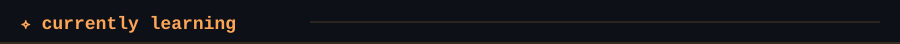

<table>
  <tr>
    <td>
      <a href="https://github.com/tusharyadav24">
        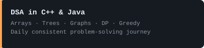
      </a>
    </td>
    <td>
      <a href="https://github.com/tusharyadav24">
        
      </a>
    </td>
  </tr>
</table>

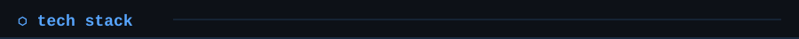

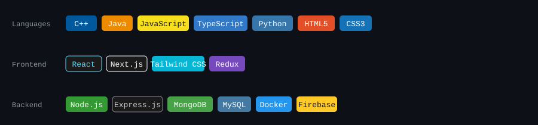

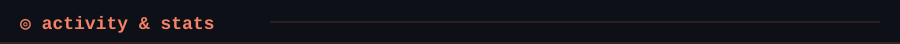

<p align="center">
  <!-- Streak: demolab.com (confirmed working) -->
  
  &nbsp;
  <!-- Stats: github-stats-extended (working replacement for dead vercel instance) -->
  
</p>

<p align="center">
  <!-- Contribution Chart: ghchart.rshah.org — static PNG, no rate limits, always works -->
  
</p>

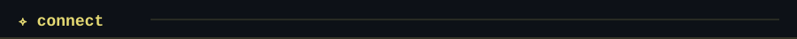

<p align="center">
  Currently mastering DSA in C++ & Java and building AI-powered full-stack applications.<br/>
  Open to internships, project collaborations, and interesting ideas to build together.<br/><br/>
  <a href="mailto:krishnasinghyadav24@gmail.com">krishnasinghyadav24@gmail.com</a>
  &nbsp;·&nbsp;
  <a href="https://www.linkedin.com/in/tushar-yadav24/">linkedin.com/in/tushar-yadav24</a>
</p>

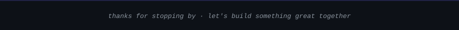
